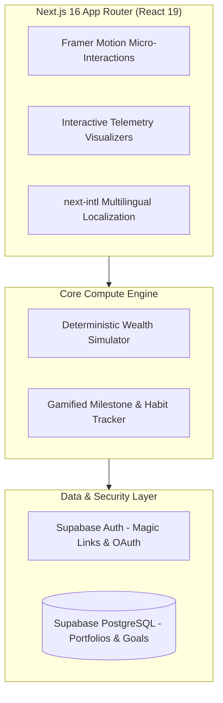

```text
 ╔═══════════════════════════════════════════════════════════════════════════════════════╗
 ║   █████╗ ██████╗ ████████╗██╗  ██╗██╗   ██╗ ██████╗                                  ║
 ║  ██╔══██╗██╔══██╗╚══██╔══╝██║  ██║██║   ██║██╔═══██╗                                 ║
 ║  ███████║██████╔╝   ██║   ███████║██║   ██║██║   ██║                                 ║
 ║  ██╔══██║██╔══██╗   ██║   ██╔══██║╚██╗ ██╔╝██║   ██║                                 ║
 ║  ██║  ██║██║  ██║   ██║   ██║  ██║ ╚████╔╝ ╚██████╔╝                                 ║
 ║  ╚═╝  ╚═╝╚═╝  ╚═╝   ╚═╝   ╚═╝  ╚═╝  ╚═══╝   ╚═════╝                                  ║
 ║                                                                                       ║
 ║   [★] INDIA'S FIRST GAMIFIED WEALTH UNIVERSE FOR YOUNG BHARAT (18–35)                 ║
 ║   [⚔] GTM ADOPTION ENGINE :: NEXT.JS 16 · REACT 19 · TYPESCRIPT · SUPABASE           ║
 ╚═══════════════════════════════════════════════════════════════════════════════════════╝
```

<div align="center">

[-000000?style=for-the-badge&logo=nextdotjs)](https://nextjs.org)
[](https://react.dev)
[](https://www.typescriptlang.org)
[](https://supabase.com)
[](https://tailwindcss.com)
[](LICENSE)

</div>

```text
 ┌─[ PIXEL STATUS HUD ]─────────────────────────────────────────────────────────────────┐
 │ SYSTEM : ● ONLINE           │ UI CRAFT : OBSIDIAN GLASS   │ STACK: REACT 19 + NEXT 16 │
 │ GTM TARGET: 500M YOUTH      ──(EMOTIONAL TOOLS > DRY MATH)──► VIRAL ADOPTION LOOPS   │
 │ CORE THESIS: "Arth" (Purpose/Wealth) + "Vo" (Identity) = Self-Sovereign Finance      │
 └──────────────────────────────────────────────────────────────────────────────────────┘
```

---

## 🧭 The Vision & GTM Product Thesis

> *"500 million young Indians will retire broke if nobody reaches them. Only 8% of India's youth workforce under 35 has an active NPS account. PFRDA, banks, and traditional institutions have failed to reach them for 20 years because they built dry information tools. Nobody built emotional tools."*

**Arthvo** (*Sanskrit:* **Arth** = Purpose / Wealth; **Vo** = Identity / Person &rarr; *"The one who understands money"*) is India's first gamified financial awareness universe for young citizens aged 18–35.

It is not just another pension calculator or budget spreadsheet; it is an interactive simulation ecosystem where young Indians learn how compound interest, inflation, debt traps, and sovereign retirement funds interact with their actual life aspirations in their own language and pace.

```text
 [ Dry Spreadsheets / Bank Portals ] ──► (Friction: 92% Abandonment) ──► ❌ Debt Trap
                    │
                    ▼ (Arthvo Gamified Design)
 [ Life Aspirations ] ──► [ Delay Penalty Simulator ] ──► [ Vernacular RPG Quest ] ──► 🚀 Financial Sovereignty
```

---

## 🏛️ System Architecture



---

## ✨ Core Pillars & Experience

```text
 ┌──────────────────────────────────────┐     ┌──────────────────────────────────────┐
 │       HIGH-CRAFT UI/UX DESIGN        │     │         GTM GROWTH ENGINE            │
 ├──────────────────────────────────────┤     ├──────────────────────────────────────┤
 │ • Dark Obsidian & Cyber Glass Theme  │     │ • Peer-to-Peer Campus Challenges     │
 │ • Gamified Quest Progression Tree    │ ──► │ • Zero Jargon Micro-Learning Bites   │
 │ • Interactive Real-Time Sliders      │     │ • Social Milestone Unlock Cards      │
 │ • 60fps Spring Motion Feedback       │     │ • Frictionless Self-Serve Onramps    │
 └──────────────────────────────────────┘     └──────────────────────────────────────┘
```

1. **Gamified Quest Paths:** Complex financial milestones broken into bite-sized chapters with unlockable achievements.
2. **Deterministic Delay Penalty Engine:** Demonstrating the true mathematical cost of waiting 5 years to start investing through visual interactive comparison graphs.
3. **Vernacular Adaptation:** Multilingual support bridging India's linguistic diversity.

---

## 🛠️ Tech Stack & Tooling

- **Framework:** Next.js 16 (App Router) with React 19
- **Type Safety:** TypeScript 5.x
- **Styling & Design System:** Tailwind CSS v4 with bespoke obsidian glass utilities
- **Backend & Database:** Supabase (PostgreSQL, Row-Level Security, Real-Time Subscriptions)
- **State & Telemetry:** React Context + Custom Hook Architecture

---

## 🚀 Running Locally

```bash
# 1. Clone & Navigate
git clone https://github.com/ShivamRaut1610/Arthvo.git
cd Arthvo/arthvo-app

# 2. Install dependencies
npm install

# 3. Launch Development Server
npm run dev
```

*Open `http://localhost:3000` in your browser.*

---

## 👤 Author & Architecture
- **Shivam Raut** — *Founder, GTM & Design Engineer* ([@ShivamRaut1610](https://github.com/ShivamRaut1610))

## 📄 License
This repository is open-sourced under the [MIT License](LICENSE).
