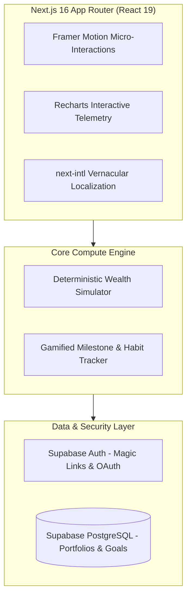

# Arthvo 💎
### Gamified Financial Awareness Universe for Young India

[-000000?style=for-the-badge&logo=nextdotjs)](https://nextjs.org)
[](https://react.dev)
[](https://www.typescriptlang.org)
[](https://supabase.com)
[](https://tailwindcss.com)
[](LICENSE)

---

## 🧭 The Vision & Mission

> *"500 million young Indians will retire broke if nobody reaches them. Only 8% of India's youth workforce under 35 has an active NPS account. PFRDA, banks, and traditional institutions have failed to reach them for 20 years because they built dry information tools. Nobody built emotional tools."*

**Arthvo** (*Sanskrit:* **Arth** = Purpose / Wealth; **Vo** = Identity / Person &rarr; *"The one who understands money"*) is India's first gamified financial awareness universe for young citizens aged 18–35.

It is not just another pension calculator or budget spreadsheet; it is an interactive simulation ecosystem where young Indians learn how compound interest, inflation, debt traps, and sovereign retirement funds interact with their actual life aspirations in their own language and pace.

---

## 🏛️ System Architecture



---

## ✨ Core Pillars & Experience

1. **The Wealth Horizon Simulator:** Interactive compounding charts that show the brutal mathematical cost of delaying investment by 1, 3, or 5 years.
2. **Vernacular Financial Literacy:** Translates complex financial jargon (*"Annuity options"*, *"80CCD (1B)"*, *"NAV"*, *"Active vs Auto Choice"*) into everyday cultural analogies.
3. **Identity-Driven Milestones:** Gamified quests that unlock tier levels as users track simulated asset allocation across Equities, Debt, and Sovereign funds.

---

## 📁 Repository Structure

```
Arthvo/
├── arthvo-app/               # Production Next.js 16 web application
│   ├── app/                  # App Router pages and layouts
│   ├── components/           # UI components, interactive charts & forms
│   ├── public/               # Static assets & brand vectors
│   ├── package.json          # Dependencies (Next 16, React 19, Supabase, Tailwind v4)
│   └── tsconfig.json         # TypeScript configuration
├── 1-ARTHVO-VISION.md        # Comprehensive Product, Identity & Soul Document
├── 2-ARTHVO-TECHNICAL.md     # Engineering Specifications & Mathematical Proofs
├── Arthvo-logo.jpeg          # Official brand mark
└── README.md                 # Public repository documentation
```

---

## 🚀 Quickstart Guide

### 1. Prerequisites
- Node.js >= 20.x
- npm / yarn / pnpm

### 2. Run the Development Server
```bash
# Navigate to the web application directory
cd arthvo-app

# Install dependencies
npm install

# Start the Next.js local development server
npm run dev
```
Open [http://localhost:3000](http://localhost:3000) with your browser to experience the universe.

### 3. Production Build
```bash
npm run build
npm start
```

---

## 📚 Deep Dive Specifications
For comprehensive documentation on the product thesis and technical architecture, review:
*   📖 [**`1-ARTHVO-VISION.md`**](1-ARTHVO-VISION.md) — Product Philosophy, Persona Research, and Tone of Voice.
*   🛠️ [**`2-ARTHVO-TECHNICAL.md`**](2-ARTHVO-TECHNICAL.md) — Formulae, Simulation Math, and Security Controls.

---

## 👤 Author & Architecture
- **Shivam Raut** — Founder & Architect ([@ShivamRaut1610](https://github.com/ShivamRaut1610))

## 📄 License
This repository is open-sourced under the [MIT License](LICENSE).
